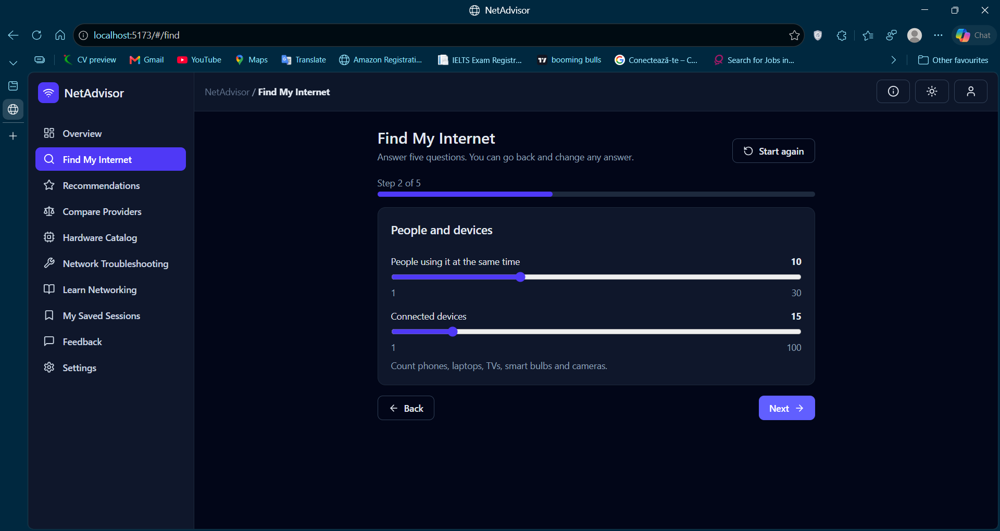
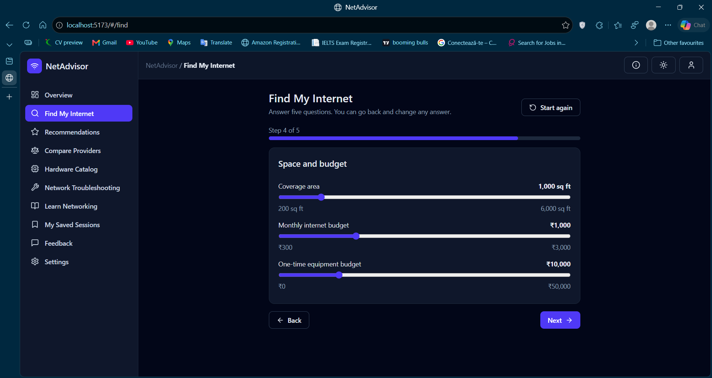
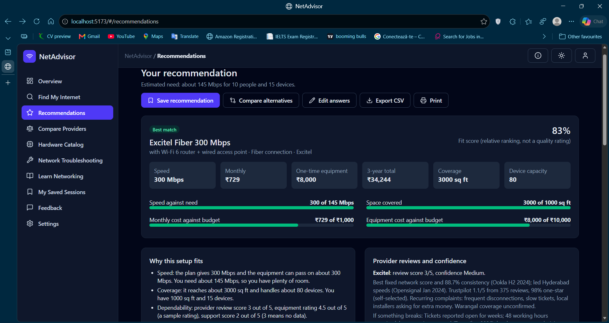
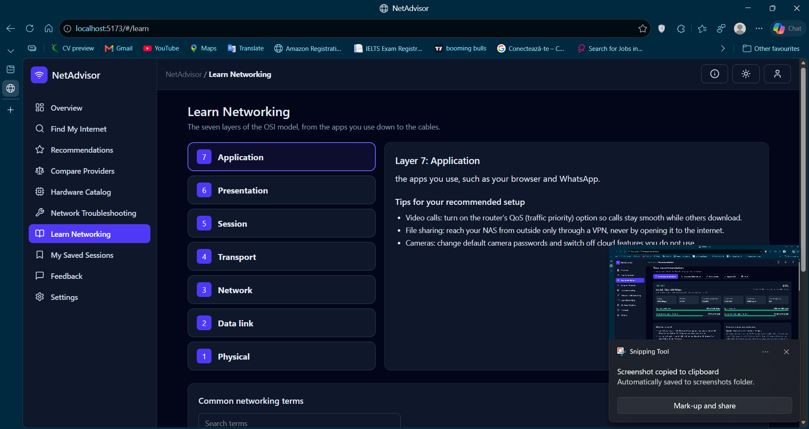
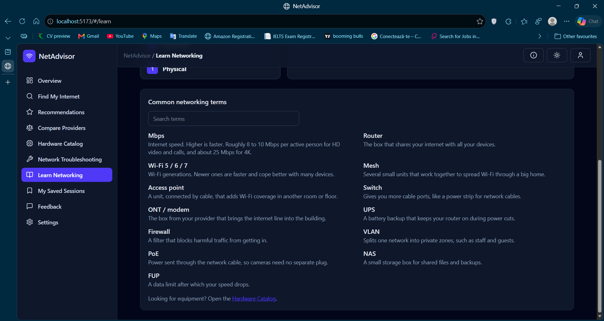

<div align="center">

# 🌐 NetAdvisor

### Find the right internet setup for your home — without the guesswork.

**NetAdvisor** is a network setup recommendation app that helps users explore internet plans, compare networking hardware, estimate setup needs, and learn networking fundamentals in one place.

<p>
  
  
  
  
</p>

<p>
  <a href="#-features">Features</a> •
  <a href="#-screenshots">Screenshots</a> •
  <a href="#-getting-started">Get Started</a> •
  <a href="#-how-it-works">How It Works</a> •
  <a href="#-project-structure">Project Structure</a> •
  <a href="#-roadmap">Roadmap</a>
</p>

</div>

---

## 📌 About the Project

Choosing an internet plan is not only about selecting the highest speed. The right setup also depends on your budget, home size, number of connected devices, coverage needs, and compatible networking equipment.

NetAdvisor brings these considerations together in a guided experience. Users can enter their requirements, review suitable options, compare plans, explore hardware, and learn the networking concepts behind their choices.

> **Project note:** ISP prices, availability, plan details, ratings, and coverage should be treated as estimates or sample data unless they are verified against the provider. NetAdvisor is a decision-support tool, not a guarantee of service availability.

## ✨ Features

<table>
<tr>
<td width="50%">

### 🧭 Guided Setup Wizard
Answer questions about your household, connected devices, coverage requirements, speed needs, and budget.

</td>
<td width="50%">

### 🎯 Personalized Recommendations
Rank candidate internet plans and hardware based on the requirements entered by the user.

</td>
</tr>
<tr>
<td width="50%">

### ⚖️ Plan Comparison
Review plan details, estimated costs, speeds, and trade-offs to make a more informed choice.

</td>
<td width="50%">

### 🧰 Hardware Catalogue
Explore networking equipment such as routers, mesh systems, ONTs, access points, and switches.

</td>
</tr>
<tr>
<td width="50%">

### 📚 Learn Networking
Build foundational knowledge of networks and explore the seven layers of the OSI model.

</td>
<td width="50%">

### 🛠️ Troubleshooting Guidance
Use guided tips to understand common connectivity issues and possible next steps.

</td>
</tr>
<tr>
<td width="50%">

### 💾 Saved Sessions & Feedback
Keep track of supported saved-session data and share feedback, depending on the configured app features.

</td>
<td width="50%">

### 📱 Responsive Interface
Designed to make the main workflow usable across desktop, tablet, and mobile screen sizes.

</td>
</tr>
</table>

## 🖼️ Screenshots

The screenshots below show examples of the current interface. Replace them with updated screenshots whenever the UI changes.

### 1. Find My Internet — Budget and Requirements



### 2. Coverage and Space Configuration



### 3. Recommendation Results



### 4. Learn Networking — OSI Model



### 5. Networking Layers and Learning Content



## 🚀 Getting Started

### Prerequisites

Before running the project, install:

- **Node.js** — use a current LTS version compatible with the project.
- **npm** — included with Node.js.
- **Git** — to clone and manage the source code.

Check your installations:

```bash
node --version
npm --version
git --version
```

### Installation

Clone the repository:

```bash
git clone https://github.com/Naveed1801n/Netadvisor.git
```

Move into the project directory:

```bash
cd Netadvisor
```

Install dependencies:

```bash
npm install
```

Start the development server:

```bash
npm run dev
```

Open the local URL printed in your terminal (Vite commonly uses `http://localhost:5173`).

### Production Build

Build the app:

```bash
npm run build
```

Preview the production build locally:

```bash
npm run preview
```

> If your project uses different scripts, check the `scripts` section in `package.json` and update these commands to match.

## 🧠 How It Works

1. **Enter requirements** — provide the budget, coverage area, speed expectations, and number of devices.
2. **Evaluate options** — the recommendation logic evaluates available plans and relevant equipment.
3. **Review recommendations** — compare the suggested option with alternatives and inspect the reasons behind the ranking.
4. **Explore hardware** — review equipment options and compatibility considerations.
5. **Learn and troubleshoot** — use the learning and troubleshooting sections to understand your network and common issues.

### Recommendation principles

A useful recommendation should consider several factors together:

- Budget fit, including recurring and one-time costs.
- Whether the plan can meet the requested speed.
- Coverage requirements and the need for additional access points or mesh equipment.
- The expected number of connected devices.
- Compatibility between the selected plan and hardware.
- Clear explanations of trade-offs and unmet requirements.

A recommendation score is a **relative fit score**, not a guarantee of real-world ISP performance. If no available option meets every constraint, the app should explain that and show the closest alternatives rather than presenting an unsuitable option as a perfect match.

## 🧱 Project Structure

The exact structure may vary with the current implementation. A typical React/Vite project looks like this:

```text
Netadvisor/
├── public/
├── src/
│   ├── components/       # Reusable UI components
│   ├── pages/            # Main app pages or views
│   ├── data/             # Provider and hardware data
│   ├── utils/            # Recommendation and helper logic
│   ├── App.jsx
│   └── main.jsx
├── assets/
│   └── screenshots/      # README screenshots
├── index.html
├── package.json
└── README.md
```

Use the actual folders in your repository as the source of truth; do not create unused folders just to match this example.

## 🧰 Technology

The project is built as a web application. Confirm the exact packages and versions in `package.json`.

- **React** — component-based UI.
- **JavaScript** — application logic.
- **CSS / project styling system** — layout, responsive styles, and visual design.
- **Vite** — development server and build tool, if configured in the project.

Additional libraries such as routing, icon sets, charting, or animation tools should be listed here only if they are installed and used by the current codebase.

## 🗺️ Roadmap

- [ ] Improve recommendation accuracy and explain ranking factors.
- [ ] Make budget constraints and over-budget options clear.
- [ ] Add or refine product images in the hardware catalogue.
- [ ] Expand beginner-friendly networking lessons before the OSI model.
- [ ] Improve mobile usability and accessibility.
- [ ] Add tests for recommendation scenarios and important user flows.
- [ ] Keep screenshots and setup instructions updated with each major release.

## 🧪 Testing Checklist

Before publishing changes, verify:

- [ ] The development server starts successfully.
- [ ] The production build completes.
- [ ] Wizard controls update their displayed values correctly.
- [ ] Recommendations respond to changes in budget and network requirements.
- [ ] Over-budget or unsuitable plans are clearly identified.
- [ ] Hardware filters and detail actions work, if provided.
- [ ] Learning navigation and OSI layer content work.
- [ ] The layout works on desktop and mobile.
- [ ] No API keys, passwords, or private environment files are committed.

## 🤝 Contributing

Suggestions and improvements are welcome.

1. Fork the repository.
2. Create a feature branch:

   ```bash
   git checkout -b feature/your-feature
   ```

3. Commit your changes:

   ```bash
   git commit -m "Add: describe your change"
   ```

4. Push your branch:

   ```bash
   git push origin feature/your-feature
   ```

5. Open a Pull Request describing the change and how you tested it.

## 🔐 Security and Data

- Never commit API keys, passwords, access tokens, or private environment files.
- Keep `.env` files out of Git and provide a sanitized `.env.example` only if environment variables are needed.
- Explain clearly when any data is sample, estimated, or stored locally.
- Do not claim live ISP availability or pricing unless the app actually verifies it from a reliable source.

## 📄 License

No license is specified here. Add a `LICENSE` file and name the license in this section if you intend to publish the project under an open-source license.

---

<div align="center">

**Built with curiosity for better home networking. 🌐**

[⬆ Back to top](#-netadvisor)

</div>
